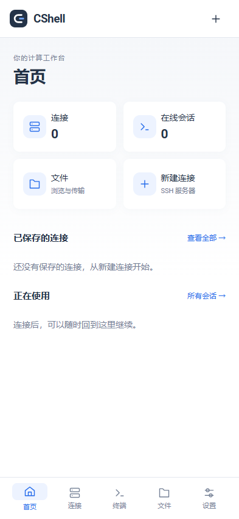
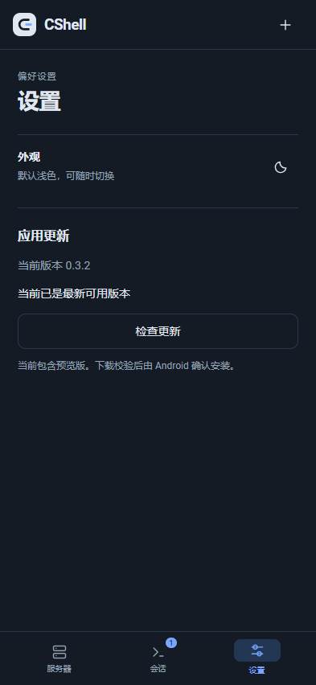

# CShell

CanpShell 是面向高频操作的终端与 AI 工作台，采用 **MIT** 许可证。当前 Windows 版本为 **CShell 0.5.0 预览版**，独立受控端为 **CShell Client 0.1.0**；macOS、Linux 和 Android 本轮未更新，继续提供 0.4.7。

[源码](https://github.com/Yeqi99/CShell) · [版本下载](https://github.com/Yeqi99/CShell/releases) · [问题反馈](https://github.com/Yeqi99/CShell/issues) · [构建状态](https://github.com/Yeqi99/CShell/actions)

白色默认界面、多标签终端、可收纳文件和资源侧栏；暗色可在右下角切换。极简模式仅保留标签与终端，并提供还原按钮。窗口依据当前屏幕可用区域缩放，切换工作区保留会话、滚动历史和草稿。SSH、配置和随包插件可离线使用，无产品账号、云同步、遥测或在线授权。

## 版本与下载

发行产物统一放到 [GitHub Releases](https://github.com/Yeqi99/CShell/releases)；市场目录固定到已发布的源码标签，不需要部署市场服务器。仓库为 [Yeqi99/CShell](https://github.com/Yeqi99/CShell)，以实际发布完成的附件为准。

- [Windows 主程序 CShell 0.5.0](https://github.com/Yeqi99/CShell/releases/download/v0.5.0/CShell-0.5.0-win-x64.exe)
- [Windows 受控端 CShell Client 0.1.0](https://github.com/Yeqi99/CShell/releases/download/v0.5.0/CShell-Client-0.1.0-win-x64.exe)
- [SHA-256 校验文件](https://github.com/Yeqi99/CShell/releases/download/v0.5.0/SHA256SUMS.txt) · [0.5.0 发布说明](https://github.com/Yeqi99/CShell/releases/tag/v0.5.0)
- [其他平台 0.4.7 下载](https://github.com/Yeqi99/CShell/releases/tag/v0.4.7)

| 平台    | 格式 / 架构                           | 当前验证状态                                             |
| ------- | ------------------------------------- | -------------------------------------------------------- |
| Windows | NSIS `.exe`，x64                      | 0.5.0：本机构建、60 项测试及两端打包版 Client 回归通过 |
| macOS   | `.dmg` / `.zip`，Apple Silicon、Intel | 0.4.7：云端构建通过；真机交互待验收 |
| Linux   | `.AppImage` / `.deb`，x64、ARM64      | 0.4.7：云端构建通过；真机交互待验收 |
| Android | 测试 `.apk`，Android 8+               | 0.4.7：编译与 lint 通过，持久化签名；功能不等同桌面 |

尚无商业代码签名证书，macOS 未公证。核对附件的 SHA256SUMS.txt。完整范围见 [发布说明](docs/RELEASE.md)，已执行的检查见 [验证记录](docs/VALIDATION.md)。

## Android 工作台与更新

Android 默认进入概览首页，底部导航为首页、连接、终端、文件、设置。支持搜索、分组、会话切换与独立连接页。文件页绑定所选在线会话，支持目录浏览、只读文本预览、上传与下载；使用系统文件选择器，不请求整个设备存储权限。切页保留终端和未提交草稿，连接按钮固定在操作区；密码与私钥不落盘。设置中可切换明暗、检查和下载更新。

桌面与 Android 均从 GitHub Releases 检查更新并校验 SHA256，随后进入系统安装流程。Linux 当前提供 AppImage 下载和文件位置，需要手动替换与授权执行。更新不会自动关闭正在操作的会话。

**从 Android 0.3.1 升级需注意签名变化**：旧版是临时调试签名，需要卸载后重装，卸载会清除本地配置。0.3.2 开始复用持久化发布签名，后续版本可覆盖更新。

 

## 统计与连接架构

顶栏“统计与历史”展示本设备真实记录：成功连接、文件操作请求、传输字节、AI 请求和活跃日期；支持日期/类型筛选、搜索、CSV/HTML 导出、暂停及清空。仅本机存储，最多一年/50,000 条，不采集终端输入、密码、文件路径或聊天正文，不伪造旧历史、Token 数或效率收益。

连接生命周期与 Agent 工具采用 [Connection Provider Architecture](docs/CONNECTION-PROVIDERS.md)。SSH、Windows 本机终端和 CShell Client 使用独立 Provider。Client 与 SSH 共用左侧服务器列表，支持命名、分组、收藏、编辑和双击连接，旧设备记录自动迁入。RDP 通过 Windows mstsc 打开独立窗口，暂不保存配置；VNC 与直连 Docker TLS 尚未实现。现有 Docker 插件使用真实 Engine HTTP API，经 SSH socket 隧道访问。

### CShell Client

Client 安装在被管理的 Windows 电脑上，与主程序独立运行。设置监听地址、端口、连接密码和允许的 CMD / PowerShell 后启动服务；在主程序新建连接中选择 CShell Client，填写信息或显式粘贴复制的信息，核对设备指纹后连接。复制内容不含密码，凭据独立加密保存，不进入外观方案。

Client 默认不监听、不开放防火墙、不提升权限。本机回环连接已验证，跨机器局域网、休眠恢复与长期断网仍待验收；暂不提供文件传输、屏幕控制、中继、Windows 服务或 WSL 一键安装。详见 [Client 使用与安全边界](docs/CLIENT.md)。

## AI 智能体

顶栏机器人入口管理多个 OpenAI 兼容 API URL、Key、模型和会话。按应用能力与机器范围统一授权，支持单台机器覆盖；全提示、限制执行、全放行只改变审核方式，不扩大已授权范围。默认权限关闭，密钥与历史在本机加密保存。用户发送后，消息及授权工具结果发送至选定供应商。翻译、输入辅助与连接提取可选择各自基座，生成候选不会自动执行。详见 [基座、会话和权限](docs/AI.md) 与 [文字助手](docs/TEXT-ASSIST.md)。

## 开发与构建

桌面构建需要 Node.js 24 和 pnpm 11.25.0，在目标操作系统打包。Android 另需 JDK、Gradle 与 Android SDK，见 [移动端说明](android/README.md)。

```sh
pnpm install --frozen-lockfile
pnpm build
pnpm start
pnpm test
pnpm test:desktop
pnpm run dist
```

`release/0.5.0/CShell-0.5.0-win-x64.exe` 为 NSIS 安装包，`release/0.5.0/win-unpacked/CShell.exe` 为目录版。使用 `pnpm dist:client` 构建独立受控端，产物位于 `release/client-0.1.0/`。macOS 使用 `pnpm exec electron-builder --mac --arm64 --publish never`，Linux 使用 `pnpm exec electron-builder --linux --x64 --publish never`；本轮未发布这些平台的新包。首次安装依赖和构建需要网络。

## 插件与应用

顶栏“插件与应用”打开工作区扩展页。Vim、Nano、Shell 联想、Docker、Anaconda、Python 统一支持安装、启停与卸载，状态独立于外观方案。默认插件与应用目录指向 GitHub `marketplace/`，随包目录作为离线回退；读取目录与安装显式操作，下载验证 SHA-256。完整协议和包制作命令见 [插件协议](docs/PLUGINS.md)。内置功能提供器随客户端编译，第三方 v1 包只支持声明式命令；应用目录只引用当前客户端支持的安装配方，不执行任意远程清单脚本。

应用市场选择已连接服务器，检查安装条件并显示安装计划，点击后执行并记录输出。提供 Miniconda、Anaconda、Conda Python 环境、JupyterLab、Jedi，以及 Debian/Ubuntu 的 Nginx、Redis 配方；安装目录、Python 版本、环境和权限限制见协议文档。不会自动在你的服务器上安装任何软件。

Anaconda 插件识别实际 Conda 环境，可创建、删除非 base 环境、查看和安装依赖，在选定环境新开终端；Jupyter 通过 SSH 回环隧道打开并可停止。Python 插件双击远端 .py 文件即进入编辑页，按所选解释器提供 Jedi 补全、签名、语法诊断、保存冲突检查；编辑草稿在工作区切换时保留。终端观察到 Python/IPython 启动后按实际提示符提供补全；无法确认解释器时选择环境，不猜测虚拟环境。Vim/Nano 内 Python LSP、完整调试和重构不在当前实现中。

## 外观、布局与配置

默认浅色，右下角可一键切换明暗主题并保存选择。连接页只展开地址、端口和认证；手动填写是默认方式。复制 `ssh user@host -p 2222` 后，点击“从剪贴板提取”才填入地址、端口和用户名，也支持 `-l user`；保留认证方式与已填密码。主机输入框只填主机，不隐式提取命令；命令不执行，不支持的选项会就地报错。名称选填，默认使用主机名。

默认“连接”为临时会话，不保存配置或凭据。勾选“保存到服务器列表”才展开名称、分组与凭据保存选项，此时按钮为“保存并连接”和“仅保存”：前者先保存配置，认证成功后才按选择保存凭据；连接失败仍保留配置。通过标签上的关闭按钮放弃草稿。常规尺寸下操作按钮紧跟内容，不采用遮挡表单的固定底栏。

标签整块可点击、可关闭；会话标签支持拖动排序、F2/双击重命名。切换终端、编辑、设置和不同服务器，保留终端内容、连接草稿及各会话的文件目录。命令搜索为顶栏下方的紧凑列表，支持方向键、Enter 和 Escape，不挤动工作区；还原布局通过搜索查找。

监控采用紧凑信息行，展示 CPU 使用率和逻辑核心数、内存及根文件系统的已用/总容量（二进制单位）、SSH 命令往返耗时。CPU 使用率需要两次采样，连续三次无有效数据时显示不可用并可重试；采集失败清除过期数据。内存使用量按总量减可用量计算，磁盘百分比采用文件系统报告值。文件与资源可分别折叠；隐藏监控时停止轮询，切换时只采集当前连接。

偏好设置自动列出本机字体，支持筛选、即时预览、拖入或选择字体文件。界面背景可选择或拖入图片，并调整可见度、模糊与填充方式；取消恢复原样。字体和图片仅存本机。

拖动面板标题处的把手可交换服务器、终端、文件面板的位置；拖动边界调整宽度，键盘也支持 Alt+方向键换位及分隔条方向键缩放。命令菜单内提供“还原默认布局”。设置中可保存命名配置、切换预览、导入导出；导出包含自定义字体和背景，不含服务器凭据。

右下角语言按钮展开选择菜单。右侧文件面板中文为“文件”，英文为“File”。文件路径可直接编辑与复制；操作栏使用统一图标、悬停/键盘焦点提示，根据选择显示上传、新建、下载、复制、粘贴、重命名和删除。文件错误留在所属面板，传输队列按会话归属过滤。

默认终端字号 14 px、行高 1.2，可分别配置；切换主题同步更新背景、前景、16 色 ANSI 色板、光标和选区。快捷操作提示放在右键菜单，不长期挤占终端。

## Vim / Nano 操作面板

识别到常见 Vim、Neovim 或 Nano 全屏界面时，终端底部显示紧凑图标面板。点击直接跳到文件开头/结尾、跳行、搜索、切换匹配、撤销/重做和保存，操作后焦点回到终端。快捷键仅在悬浮提示中展示，没有教学列表或长期说明。

Vim 搜索和跳行按需展开一行输入，搜索按字面匹配，特殊字符经过引用处理；发送操作前统一返回普通模式。常驻入口支持退出当前模式、切入插入模式和退出编辑器；更多菜单包含行尾插入、字符/行/块选择、替换，以及保存退出、退出所有窗口。Nano 搜索、跳行、保存和退出交给原生提示继续处理，保留文件名确认与未保存修改判断；支持默认/现代键位切换。Vim 放弃全部未保存修改并退出需要确认；Nano 提供取消当前搜索/文件名输入入口。

只向当前活动、仍在全屏缓冲区且未断开的会话发送用户点击的操作。发现编辑器正等待确认或输入时，就地提示，不继续发送其他操作。识别依据当前屏幕特征及最近的编辑器启动输入，不执行远端进程探测；定制状态栏、映射、别名及 tmux/screen 可能需要手动识别或直接使用终端。右键菜单可切换 Vim / Nano、恢复自动或关闭面板；手动选择也不能向普通 Shell 发送编辑器命令。

## Linux 命令联想

默认启用常用 Linux、Git 与 Docker 命令前缀联想。在可识别的普通 Shell 提示符处输入，点击候选或按 Ctrl+Space 只补全剩余内容，不发送 Enter；Alt+上下方向键切换候选，Escape 收起。保留 Shell 原生 Tab 和上下历史操作。密码提示、全屏程序、光标移到行中或不确定的输入状态不提供联想；自定义提示符和多行命令不保证支持。可在“偏好设置 → 终端与 Docker”关闭。候选为本地命令库，不读取或上传历史，也不推断远端是否安装了对应程序。

## Docker 工作台

在“偏好设置 → 终端与 Docker”启用 Docker 面板并保存，当前已连接会话右侧出现 Docker 入口。容器支持全部/运行中/已停止/已暂停分类，按名称、镜像、Compose 项目或 ID 搜索；所选运行容器每 5 秒采集 CPU、内存、累计网络流量和 PIDs。CPU 100% 表示占满一个逻辑核心。镜像列表支持从本地镜像创建容器、端口映射和启动；没有隐式拉取镜像。

使用当前 SSH 连接的 Unix Socket 转发访问 Docker Engine，默认路径为 /var/run/docker.sock，rootless 可填写 /run/user/UID/docker.sock。SSH 用户需要已有 Socket 访问权限，SSH 服务必须允许 StreamLocal 转发。不会自动 sudo、改变权限或开放 Docker TCP 端口。Docker 和命令联想设置独立持久化，不随外观方案导入导出。

容器可启动、停止、重启、暂停/恢复；删除需要确认，不强制删除运行中容器，不删除数据卷。修改端口需要确认重建：先停止原容器，提交可写层快照，再用原配置、环境变量和挂载创建新容器；保留停止状态的旧容器及本地快照，失败尝试恢复原容器名称、重启策略和原运行状态。备份可在列表中管理。网络累计流量、tmpfs 等运行时状态不会跨重建保留。断线/超时可能需要刷新并核实操作结果，不能视为事务保证。

Compose / Swarm 管理的容器不通过该入口重建，避免与部署声明冲突；其端口应在部署配置中修改。host/none/container 网络模式、自动删除和异常状态容器不支持端口重建。其他生命周期操作仍按 Docker 的实际响应反馈。当前验证使用 SSH 上的 Engine API 测试服务，真实 Docker 发行版、存储驱动、复杂网络和大型容器重建仍需兼容性验收。

依据：[Docker Engine API](https://docs.docker.com/reference/api/engine/)、[端口发布](https://docs.docker.com/engine/network/port-publishing/)。

## MCP

默认关闭，偏好设置中可启用本机 MCP 服务、配置端口、选择授权服务器和复制令牌。命令执行单独授权且逐条确认。详见 [接入说明](docs/MCP.md)。

## 当前功能

- SSH 密码 / 私钥认证；首次主机指纹确认，主机密钥变化拒绝连接。
- 分组、收藏、搜索、连接编辑；多标签终端、调整尺寸、历史滚动、搜索及 Unicode 11 字宽处理。
- SFTP 浏览、上传/下载、递归目录传输、重命名、删除文件/空目录、新建目录。
- 原生文件选择器上传、从资源管理器拖入上传；应用内本地/远端面板间拖拽、Ctrl+C/V 文件复制粘贴；目录间复制与移动。
- 传输队列、流式进度、取消；文件写入临时路径后提交；上传覆盖依赖服务器原子重命名扩展，不支持时保留原件并报错。
- Windows DPAPI 保护可选保存的密码、私钥内容和私钥口令。凭据不会返回界面。
- Linux CPU、内存、根磁盘监控；命令往返耗时（不是 ICMP ping）。
- 中英运行时切换、深浅主题、界面/终端字体独立配置。

配置位于 Electron 的用户数据目录：Windows 通常为 `%APPDATA%/canpshell/config.json`。连接名称、地址和主机指纹不是秘密，配置中保持可读；凭据单独加密。损坏配置会阻止启动并保留原文件，不会静默覆盖。

新建连接和偏好设置使用工作区页签；查找以及文件新建、重命名在界面内展开。仅当前终端已连接时显示对应的 SFTP 和监控面板。

## 常用操作

双击服务器在工作区打开连接编辑页；星标按钮收藏；右键或省略号打开紧凑菜单，可编辑、移至分组或删除连接。菜单浮于列表上方，不挤动布局，支持方向键、Enter 和 Escape。

服务器列表上方提供“新建分组”；分组标题右侧菜单可重命名或删除分组。空分组会保留；删除分组只将连接移回“未分组”，不会删除连接或凭据。移动和改名不影响正在运行的终端。连接表单的分组字段可选择已有名称或输入新名称。

| 快捷键                        | 行为                       |
| ----------------------------- | -------------------------- |
| Ctrl+Shift+N                  | 新建连接                   |
| Ctrl+Shift+P                  | 命令面板                   |
| Ctrl+Shift+F                  | 搜索当前终端               |
| Ctrl+Shift+C / V              | 终端复制 / 粘贴            |
| Ctrl+C                        | 终端发送中断控制字符       |
| Ctrl+,                        | 偏好设置                   |
| Ctrl+Shift+B / E              | 左侧 / 右侧面板            |
| Ctrl+Tab / Ctrl+Shift+Tab     | 下一个 / 上一个工作区标签  |
| Ctrl+Shift+= / - / 0          | 放大 / 缩小 / 重置终端字号 |
| F2、双击（会话标签）          | 重命名当前会话标签         |
| Ctrl+C / V（文件面板）        | 应用内文件复制 / 粘贴      |
| Ctrl+A、Ctrl+单击（文件面板） | 全选、多选                 |
| F2 / Delete（文件面板）       | 重命名 / 确认删除          |

本地和远端之间的拖放为复制；同一远端会话内拖入目录默认移动，Ctrl 修饰为复制。移动需要确认。文件剪贴板是应用内部的，不宣称支持 Windows 资源管理器的系统文件剪贴板，也不支持将远端条目直接拖出到资源管理器。目录删除仅允许空目录，避免误删整棵树。

## 已知边界

详见 [路线图](docs/ROADMAP.md) 和 [验证记录](docs/VALIDATION.md)。未完成能力包括：标签内多终端拆分、SSH Agent/系统密钥发现、SSH Config 导入、系统级远端拖出、断点续传、跨盘移动回退、递归删除、连接超时前主动取消、代理/跳板机、主机指纹管理界面、正式签名、真实 Linux 服务器和长时间压力验收、Web 嵌入、Android 桌面功能补齐。界面没有为这些能力放置不可用入口。macOS/Linux 已打包，真机交互验证尚未完成。

本预览版不适用于不可信多租户 Web 嵌入。未来浏览器版本必须通过授权服务端网关连接 SSH，详情见 [架构决策](docs/ARCHITECTURE.md)。AI 不在后台自动读取终端输入；只有用户发送任务后才会请求配置的基座与已授权工具。

## 许可证

自有代码采用 [MIT](LICENSE)，允许使用、修改和商业分发，并保留版权及许可声明。第三方组件保持各自许可证；运行 `pnpm run licenses` 更新 [依赖清单](docs/dependency-licenses.json) 和 [第三方声明](THIRD_PARTY_NOTICES.txt)。Electron/Chromium 与 Android 依赖的许可证随各自发行物保留。

### Windows 本机终端

标签栏的终端图标可新建 CMD 或 Windows PowerShell，会话使用原生 ConPTY，可与 SSH 标签同时运行，并可放入极简模式或独立小窗。

“偏好设置 → 本机终端”可查看继承的系统、用户环境变量并设置 CShell 覆盖值。新会话重新读取 Windows 环境；覆盖值在本机加密保存，不修改注册表、不混入外观方案，也不影响已运行的会话。

“插件市场 → WSL Linux”提供本机 Linux 发行版发现与终端入口。需要 Windows 已启用 WSL 并安装发行版；插件不会自动启用系统组件或下载 Linux。没有可用环境时会显示安装命令入口。

## CShell Client（开发中）

Windows 受控端与 CShell 工作台使用独立的设备配对和加密直连通道，当前支持真实 CMD / PowerShell 终端。开发启动 `pnpm start:client`；使用步骤、权限与实验协议边界见 [Client 说明](docs/CLIENT.md)。本地开发能力不代表已发布版本支持。
