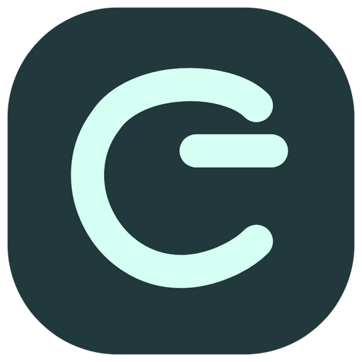

<p align="center"></p>

# CShell

CShell（CanpShell）是一款开源终端与智能体工作台，将 SSH、文件管理、远程桌面、多机器视图和自动化工具放在同一个工作空间中。适合日常服务器运维、开发环境管理，以及需要同时观察多台机器的工作。

CAgent（Canp Agent）是配套的轻量独立智能体。它可以单独运行，也可以作为 CShell 的机器代理，提供目标电脑上的终端、文件、应用能力和受授权的子任务执行。

[下载](https://github.com/Yeqi99/CShell/releases) · [0.7.0 版本说明](docs/RELEASE-0.7.0.md) · [使用文档](#文档) · [问题反馈](https://github.com/Yeqi99/CShell/issues) · [构建状态](https://github.com/Yeqi99/CShell/actions) · [MIT 许可证](LICENSE)

## 一个工作台，多种工作方式

### 连接与终端

SSH 和 CAgent 连接共用服务器列表，支持分组、收藏、搜索和双击连接。桌面端提供多标签终端、文件与资源面板、命令搜索，以及可以随时还原的极简窗口。切换页面时保留正在运行的会话、滚动历史和编辑草稿。

SSH 支持密码和私钥认证，首次连接核对主机指纹。Windows 本机终端使用 ConPTY，提供 CMD、PowerShell 和实际安装的 WSL 环境。Windows 系统 RDP 连接可保存地址与认证配置；它与 CAgent 自研远程桌面是不同的连接方式。

### 文件与编辑

在所属机器的工作区浏览和传输文件，使用拖放、复制粘贴及传输队列管理操作。SSH 文本文件可直接进入内置编辑器，选择手动保存或实时同步；冲突、写入失败与断连时保留草稿并暂停同步。

编辑器提供有界的会话内版本回退。启用 Python 扩展后，可按目标机器的真实解释器使用 Jedi 补全、签名和诊断。文本编辑目前主要面向 SSH UTF-8 文件，完整 IDE 调试、全部语言服务以及移动端编辑尚未对齐。

### 多机器视图

把 SSH、CAgent 终端、远程桌面及本机终端组合成一个视图：

- **平铺**：均匀排列多个工作区域。
- **主次**：突出当前关注的区域，其他来源保持可见。
- **小窗预览**：同时观察，点击需要的区域放大操作。

可以保存明确的机器、目录和会话来源，也可以直接编排当前连接；支持多显示器分配、布局微调和下次恢复。借用当前终端不会重新执行命令，关闭临时视图也不会关闭原终端。适合组合服务器日志、screen 会话和远程桌面等信息。详见 [视图使用说明](docs/MONITOR-VIEWS.md)。

### 智能体与自动化

配置自己的模型服务，让智能体在授权范围内检查机器、处理文件、执行命令和调用扩展工具。会话显示实际绑定的机器与模型，工具结果可以展开查看；执行审核与机器权限分别控制。

- 兼容 OpenAI 风格接口，并通过模型扩展接入其他服务。
- **OpenCode** 支持多个账号、官方设备授权、Go / Zen 模型目录选择与 Go 用量显示。
- **Tavily** 提供多 Key 网络搜索和用量查询，作为智能体工具按需启用。
- 支持子任务委派、任务检查点、上下文压缩、后台命令和有界持续执行。
- **事件订阅** 将本机或已授权远端 CAgent 的微信消息交给指定会话，配置提示词、筛选、冷却及运行预算；人工智能体会话也可通过工具管理规则。

智能体使用用户选择的模型供应商。消息和被授权的工具结果可能发送到该供应商；本地保存配置不等于模型推理在本机执行。停止、撤权、任务预算及未知结果处理见 [智能体文档](docs/AI.md) 与 [可靠性说明](docs/AGENT-RELIABILITY-0.6.35.md)。

## CAgent：机器上的轻量智能体

<p></p>

CAgent 不依赖完整 CShell、Electron 或捆绑 Chromium。Windows 提供可置顶的原生小窗口，会话、应用市场和设置按需展开；macOS / Linux 当前提供独立运行时与系统浏览器界面。

CShell 连接 CAgent 后进入整台机器的工作区，在同一上下文打开终端、文件、远程桌面、应用市场、智能体及设置。能力由目标系统、安装状态和实际授权决定，不会把控制端本机能力冒充远端能力。

Windows CAgent 的应用能力包括：

- **自研远程桌面**：原生采集、视频编码与键鼠输入，支持画质调整、网络自适应、断线恢复及中继连接。管理通道模式可复用 CAgent 的连接端口。
- **微信掌控**：在适配版本内提供通讯录、消息与文件收发、历史、备注及部分朋友圈能力；也可供已授权的 CShell 连接方调用。
- **Linux / WSL**：检查虚拟化与发行版，显示安装计划及执行结果，安装后将真实 Linux 环境加入终端选择。

CAgent 新配置为已认证控制端提供较宽松的默认能力。部署到公网前，请在“设置与权限”检查密码、监听地址、映射端口及需要开放的操作；升级保留已明确关闭的设置。设备身份核对和密码认证始终独立生效。

远控锁屏与无显示器方案涉及可选系统服务和虚拟显示驱动，仍有硬件与实机验收限制；Windows Server 的无头支持属于实验范围。详情见 [CAgent](docs/CAGENT.md)、[系统桌面服务](docs/DESKTOP-SYSTEM-BROKER.md) 和 [虚拟显示](docs/CAGENT-VIRTUAL-DISPLAY.md)。

## 下载与平台

详细差异见 [平台能力表](docs/PLATFORMS.md)。

从 [GitHub Releases](https://github.com/Yeqi99/CShell/releases) 选择对应系统和架构，核对该版本的发布说明及 `SHA256SUMS.txt`。下表说明产品平台与包类型，不表示尚未上传的版本已经发布。

[0.7.0 预发布](https://github.com/Yeqi99/CShell/releases/tag/v0.7.0) 已提供下列平台安装包，构建与检查结果见[发布验证](docs/RELEASE-0.7.0-VERIFIED.md)。

| 平台 | CShell 客户端 | 独立 CAgent |
| --- | --- | --- |
| Windows x64 | `.exe` 安装包；完整桌面工作台 | `.exe` 安装包；原生小窗，Windows 应用能力 |
| macOS Apple Silicon / Intel | `.dmg` / `.zip`；桌面客户端 | `.tar.gz`；独立运行时与浏览器界面 |
| Linux x64 / ARM64 | `.AppImage` / `.deb`；桌面客户端 | `.tar.gz`；独立运行时与浏览器界面 |
| Android | `.apk`；SSH、文件及 CAgent 连接客户端 | 暂无受控端应用 |

Android 的 SSH 支持 Android 8+；CAgent 连接要求 Android 10+。移动端已实现连接 Windows CAgent 远程桌面及触摸键鼠映射，但插件、应用安装、文件编辑和智能体工作流并不与桌面端完全相同。macOS / Linux 作为控制端与作为被控端也是不同能力，Windows 原生采集不能视为其他系统已经具备。

各平台构建结果、原生测试和真实设备验收分别记录。Android / macOS 用户设备、多个实体显示器及部分远控硬件场景仍待进一步验收。安装包签名、公证与具体兼容情况以对应发行说明为准。

## 开始使用

1. 安装 CShell，通过“新建连接”选择 SSH 或 CAgent；本机终端可以直接打开。
2. 需要管理未运行 SSH 服务的机器时，在目标机器安装 CAgent，配置连接信息后从 CShell 连接并核对身份。
3. 在机器工作区打开终端、文件或可用应用。需要同时观察多台机器时，从工作台创建视图。
4. 使用智能体前先配置模型服务和访问范围；OpenCode、Tavily、Docker、Python 等能力从扩展入口启用。

基础连接和本地配置不要求 CShell 产品账号。首次下载、软件更新、模型服务和在线搜索需要相应网络连接。偏好与布局可保存、导入和导出，凭据及授权不混入外观方案。

## 插件、应用与 API

**插件**扩展 CShell 的工作方式，例如 Vim / Nano 辅助、Python、Docker、HTTP、OpenCode 和 Tavily。**应用市场**面向选定机器，提供系统应用安装及能力包配置；安装计划与执行反馈留在目标机器上下文中。

目录与发行附件托管在 GitHub，随包目录可作为离线回退，无需单独部署市场服务。第三方包受清单、版本和摘要校验约束；安装应用与授予工具权限分别处理。

CShell 也提供默认关闭的版本化 HTTP API 与 MCP 服务，支持独立调用方、连接范围、能力授权、审核和异步任务。详见 [扩展协议](docs/PLUGINS.md)、[API](docs/API.md) 与 [MCP](docs/MCP.md)。

## 开发

桌面开发使用 Node.js 24 与仓库指定的 pnpm 版本（见 `package.json`）。原生 PTY、桌面组件及安装包需在匹配的系统与架构上构建。

```sh
pnpm install --frozen-lockfile
pnpm build
pnpm start
pnpm test
```

Windows 安装包：

```sh
pnpm run dist
```

独立 CAgent：

```sh
node scripts/agent-build.mjs
```

Android 另需 JDK、Gradle 和 Android SDK，见 [Android 构建说明](android/README.md)。平台打包、许可证和验证流程见 [发布检查清单](docs/RELEASE-CHECKLIST.md) 与 [依赖说明](docs/DEPENDENCIES.md)。

## 文档

| 内容 | 文档 |
| --- | --- |
| 版本范围、升级与已知限制 | [0.7.0 说明](docs/RELEASE-0.7.0.md) |
| 连接与机器能力 | [连接架构](docs/CONNECTION-PROVIDERS.md)、[CAgent](docs/CAGENT.md) |
| 多机器工作区 | [视图](docs/MONITOR-VIEWS.md)、[文件编辑](docs/TEXT-EDITOR.md) |
| 模型与自动化 | [智能体](docs/AI.md)、[OpenCode](docs/OPENCODE-EXTENSION.md)、[事件订阅](docs/AI-EVENTS.md)、[Tavily](docs/TAVILY-EXTENSION.md) |
| 远程桌面与平台 | [桌面协议](docs/CAGENT-DESKTOP.md)、[移动远控与 WSL](docs/MOBILE-DESKTOP-AND-WSL.md) |
| 微信适配 | [CAgent 微信](docs/CAGENT-WECHAT.md)、[文件发送](docs/WECHAT-FILE-SEND.md) |
| 外部工具接入 | [API](docs/API.md)、[MCP](docs/MCP.md)、[插件协议](docs/PLUGINS.md) |

## 反馈与贡献

欢迎通过 [Issues](https://github.com/Yeqi99/CShell/issues) 报告问题或提出建议，也欢迎提交 Pull Request。报告问题时请提供版本、系统、复现步骤，以及去除凭据和个人信息后的日志或截图。涉及平台差异时，请注明控制端和被控端各自的系统与版本。

CShell 与 CAgent 的项目源码采用 [MIT License](LICENSE)。随包第三方依赖保留各自许可证，详见 [第三方声明](THIRD_PARTY_NOTICES.txt)。
