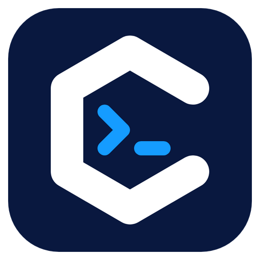

<p align="center"></p>


[](https://shell.canp.ai/usage.html)

统计口径：注册账号、最近 5 分钟活跃账号、自愿参与的匿名活跃设备分别展示，不相加；GitHub 图片可能缓存。[查看统计说明](https://shell.canp.ai/usage.html)。
# CShell

**一个工作台，连接和管理你的电脑与服务器。**

简体中文 · [English](README.en.md) · [日本語](README.ja.md)

CShell 把终端、文件、远程桌面与智能体放在同一工作台。桌面端默认双击 SSH 打开原生终端、RDP 打开远程桌面，也可按连接选择可视化工作区；CAgent 进入机器桌面。手机端使用适合触控的机器主页与应用页面。

[机房屏幕共享](docs/CLASSROOM.md) · [学生机批量部署](docs/DEPLOYMENT.md) · [官网与下载](https://shell.canp.ai/) · [完整使用手册](https://shell.canp.ai/docs/start.html) · [平台差异](docs/PLATFORMS.md) · [问题反馈](https://github.com/Yeqi99/CShell/issues) · [MIT License](LICENSE)

## CShell 和 CAgent 是什么？

| 产品 | 安装在哪里 | 用来做什么 |
| --- | --- | --- |
| **CShell** | 你正在使用的电脑或手机 | 连接机器，操作终端和文件，查看远程桌面，与智能体协作 |
| **CAgent** | 需要被管理的机器 | 向已认证的 CShell 提供该机器的终端、文件与可用应用能力；也可独立运行智能体 |

已有 SSH 服务的机器可以直接连接，**不必安装 CAgent**。需要 CAgent 的机器工作区或其远程桌面能力时，再在目标机器安装它。独立 CAgent 不依赖完整 CShell、Electron 或捆绑的浏览器；安卓通过 CShell 内的 CAgent 扩展提供受支持的被控能力。

基础连接不需要 CShell 产品账号。智能体使用你配置的模型服务，推理位置和费用由该服务决定。

## 可以做什么

- **机器桌面**：CAgent 连接进入所选机器的可视化工作区。桌面端支持窗口最小化与恢复、背景和主题；手机端提供应用入口与长按管理。
- **机器浏览器**：网页在控制端渲染，通过所选机器的网络访问。标签、历史、收藏和登录资料按机器隔离保存；断线不会回退到本机网络。支持地址联想、网页复制、全屏和数据清理。
- **远程开发应用**：在机器应用市场安装 Codex、Claude Code 或代码编辑器，核验可用后从桌面直接打开。项目和命令运行在目标机器；支持官方登录入口及自定义模型服务，具体方式取决于客户端与服务方。
- **管理连接与终端**：SSH、RDP、CAgent 与文件连接共用分组、收藏、搜索与双击连接；桌面端提供多标签和极简窗口，切换页面保留会话。连接右键菜单可记住该机器默认以可视化打开，Pro 同步此偏好。
- **处理文件**：桌面端支持独立 FTP、显式 TLS 的 FTPS 和 SFTP 文件连接；SFTP 不启动 Shell。SSH / SFTP 支持文本编辑，冲突或断线保留草稿；FTP / FTPS 提供普通文件传输和空目录操作，不提供文本编辑或递归传输。
- **远程操作电脑**：通过 CAgent 连接支持的桌面，调整画质、控制键鼠和传输文件。控制端与被控端的系统支持不同，见平台表。
- **组合工作视图**：把终端、远程桌面和智能体会话组合成平铺、主次或小窗预览布局；桌面端支持多显示器、单区域关闭及保存恢复。
- **让智能体协助工作**：连接模型服务后，在明确的机器范围内执行命令、处理文件和调用工具。可查看执行记录、审核操作、停止任务，并通过事件规则触发工作。
- **命令台与能力目录**：桌面工作台可切换概览、命令行与可视化模式；内置命令台、外部 CLI、MCP 和智能体共用已授权能力与扩展工具。命令台不连接本机 CMD / PowerShell，详见 [CLI 指南](docs/CLI.md)。
- **按需扩展**：通过插件使用 Python 补全、Docker、HTTP、OpenCode 模型接入或 Tavily 搜索；应用市场安装和配置所选机器上的能力。

模型密钥、机器授权和外观配置分别管理。智能体发送给模型服务的内容可能包括对话及已授权的工具结果。

## 快速开始

1. 从 [Releases](https://github.com/Yeqi99/CShell/releases) 下载对应系统和架构的安装包。
2. 打开 CShell，新建 SSH 连接；或在目标电脑安装 CAgent，配置地址、端口和密码，再从 CShell 连接并核对设备身份。
3. 桌面端双击 SSH 默认进入原生终端；需要机器桌面时从连接菜单打开可视化，或勾选默认可视化。CAgent 直接进入机器桌面，独立 FTP / FTPS / SFTP 进入文件工作区。
4. 需要同时观察多台机器时，在桌面工作台创建视图；需要智能体时，先配置模型服务和访问范围。

## 平台支持

| 平台 | CShell | CAgent |
| --- | --- | --- |
| Windows x64 | 桌面工作台，`.exe` 安装包 | 独立原生小窗；终端、文件及 Windows 桌面能力 |
| macOS Apple Silicon / Intel | 桌面工作台，`.dmg` / `.zip` | 独立运行时及浏览器界面；终端、文件与管理 |
| Linux x64 / ARM64 | 桌面工作台，`.AppImage` / `.deb` | 独立运行时及浏览器界面；终端、文件与管理 |
| Android | 移动客户端，`.apk`；SSH、文件、CAgent 连接及远控 | 内置扩展；系统授权后的屏幕共享与受限输入 |

**平台支持不代表所有功能完全相同。** 独立 FTP / FTPS / SFTP、工作台三种模式、外部 CLI 和官方 OpenCode 运行时属于桌面端。Android 继续使用 SSH / CAgent 内的文件功能，Pro 同步保留不消费的桌面连接字段。Android 不提供完整桌面多窗口工作台；macOS / Linux CAgent 尚无与 Windows 等价的原生桌面被控实现。安卓锁屏录屏、Windows 锁屏与无显示器控制也有系统和硬件限制。详细范围见 [平台能力表](docs/PLATFORMS.md) 和 [Android CAgent](docs/ANDROID-CAGENT.md)。

安装包是否已发布，以 Releases 实际附件为准；核对版本说明与 `SHA256SUMS.txt`。macOS 签名、公证及设备验收状态以对应发行说明为准。

### 开发应用与浏览器的边界

- CAgent 和开发应用支持选择专用安装目录，程序、私有运行时与缓存放入该目录；不替换系统 Node/Python，不修改软件源或全局 PATH。传统系统软件包会单独展示安装计划。
- 代码编辑器基于 code-server，目前自动安装面向其提供的 Linux/macOS x64、ARM64 独立包；Windows 原生安装入口不显示，可连接真实 WSL 环境使用。它不是 Microsoft 官方 VS Code 客户端。
- Android 是远程开发控制端，不在手机本机安装 Codex 或 Claude Code CLI。机器浏览器需要支持代理覆盖与独立 Profile 等能力的 System WebView；不支持时隐藏入口。
- 手机机器浏览器暂未接入网页下载，文件传输使用文件应用。移动网页 WebRTC、Service Worker 网络功能受限；账户服务是否接受内嵌浏览器由服务方决定。
- iOS 暂无发布版本；Linux 原生图形应用需逐项适配，不承诺任意 QQ、微信或桌面程序都可直接运行。

## 文档

| 主题 | 入口 |
| --- | --- |
| 连接与机器管理 | [连接](docs/CONNECTION-PROVIDERS.md) · [文件协议](docs/FTP-FTPS.md) · [CAgent](docs/CAGENT.md) |
| 工作区 | [多机器视图](docs/MONITOR-VIEWS.md) · [文件编辑](docs/TEXT-EDITOR.md) |
| 智能体 | [模型与任务](docs/AI.md) · [事件规则](docs/AI-EVENTS.md) · [OpenCode](docs/OPENCODE.md) · [Tavily](docs/TAVILY-EXTENSION.md) |
| 扩展与集成 | [插件](docs/PLUGINS.md) · [HTTP API](docs/API.md) · [MCP](docs/MCP.md) · [命令台与 CLI](docs/CLI.md) |
| 平台与构建 | [平台能力](docs/PLATFORMS.md) · [Android](android/README.md) · [依赖](docs/DEPENDENCIES.md) |

详细技术文档目前主要使用中文；本页提供中文、英文和日文版本。

## 开发与维护

使用 Node.js 24 和 `package.json` 指定的 pnpm 版本：

```sh
pnpm install --frozen-lockfile
pnpm build
pnpm start
pnpm test
```

桌面安装包使用 `pnpm run dist`，独立 CAgent 使用 `node scripts/agent-build.mjs`。原生组件需要在对应系统与架构上构建；Android 另需 JDK、Gradle 和 Android SDK。

0.8 系列完成机器桌面与开发应用收口后，开源版以错误修复、兼容性、稳定性和文档维护为主。新增产品功能主要在后续 CShell Pro 中开发；Pro 的能力与交付时间以实际发布为准。已有开源代码继续采用 MIT 许可证。

欢迎提交 [Issue](https://github.com/Yeqi99/CShell/issues) 或 Pull Request。请附版本、控制端与被控端系统、复现步骤及去除凭据的日志。随包第三方软件遵循各自许可证，见 [第三方声明](THIRD_PARTY_NOTICES.txt)。
